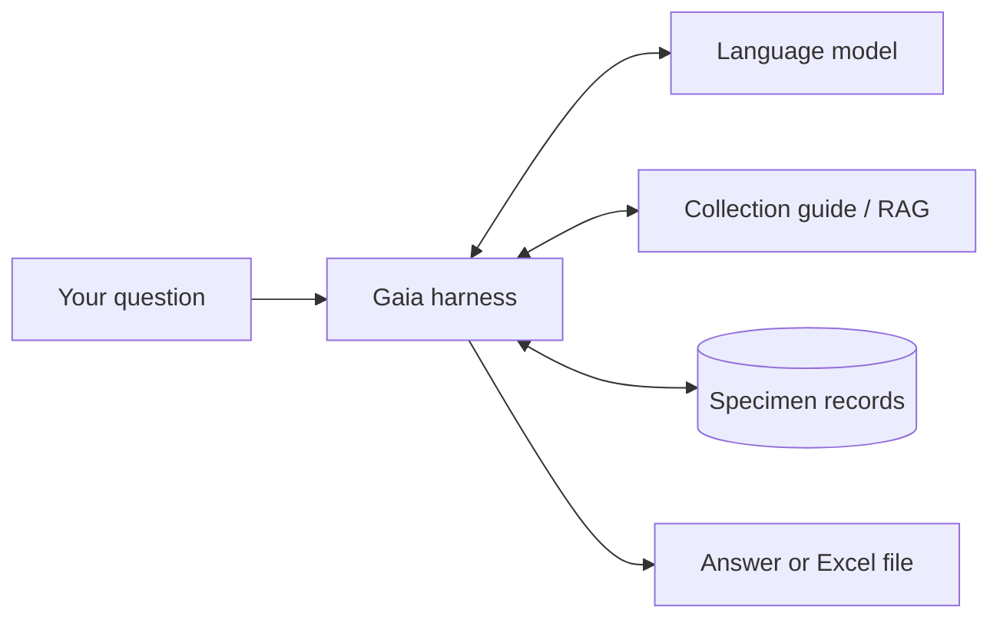

# Gaia

Gaia is a conversational interface to the Beaty Biodiversity Museum's scientific
specimen records. It supports natural-language searches, collection statistics,
and Excel exports through a terminal chat or browser interface.

The project uses Python, PostgreSQL, and Qwen 3.6 35B A3B (FP4) served by vLLM.

## How Gaia works

Gaia connects the conversation, the language model, and the museum's database.
The model interprets questions and explains findings. Gaia coordinates the work,
checks requested searches, and retrieves the records or counts needed to answer.



### Available tools

| Tool | Purpose |
| --- | --- |
| `retrieve_schema` | Retrieves collection and dataset information, available fields, and supported query formats. |
| `search_darwin_core_terms` | Searches the installed Darwin Core standard by term name, definition, class, or status. |
| `get_darwin_core_terms` | Retrieves complete standard metadata for exact Darwin Core term names or IRIs. |
| `query_occurrences` | Finds specimen records using requested filters, fields, and ordering. |
| `query_statistics` | Calculates counts, grouped summaries, and other statistics across matching records. |
| `generate_excel` | Exports matching records into Excel workbooks, with one or more dataset worksheets. |

## Data

The current dataset snapshot contains **758,834 records across 12 datasets and
6 collections**: Cowan Tetrapod, Fish, Herbarium, Marine Invertebrates,
Paleontology, and Spencer Entomology. Records include taxonomy, collecting
locations and dates, collectors, and identification details.

See the [dataset report](reports/dataset_information.md) for record counts and
field coverage.

## Requirements

- Python 3.11+.
- Docker with Docker Compose.
- GNU Make.
- A running vLLM model server with tool calling and the `/tokenize` endpoint.
- Node.js 22.13+ for the browser interface.

## vLLM settings

GX10 model-server configuration:

| Setting | Value |
| --- | --- |
| vLLM version | `0.29.0` |
| Model runner | V1 (`VLLM_USE_V2_MODEL_RUNNER=0`) |
| Model | `nvidia/Qwen3.6-35B-A3B-NVFP4`, served as `default_model` |
| Model revision | `6c7f09d4036e97393f82e9f9ecd1a5c35ca5ee92` |
| Tensor parallelism | `1` |
| Container listener | `0.0.0.0:8000` |
| Quantization and compute | ModelOpt FP4; Marlin MoE; FlashInfer attention |
| Context window | 131,072 tokens |
| GPU memory and KV cache | 83% utilization; BF16 cache |
| Multi-token prediction (MTP) | 2 speculative tokens; Triton draft MoE; standard rejection sampling |
| Scheduling | 10 sequences; 2,048 batched tokens; chunked prefill and async scheduling |
| Request admission | `--max-num-queued-reqs 15` |
| Prefix caching | Enabled |
| Generation settings | `--generation-config auto` |
| Tool calling | Automatic tool choice; `qwen3_xml` parser |
| Reasoning | `qwen3` parser; `preserve_thinking=true` |
| Performance and loading | `interactivity`; `fastsafetensors`; language-model-only mode |
| Metrics | Per-request metrics and speculative-decoding summaries |

## Setup

Run the following commands from the repository root.

### 1. Install dependencies

```bash
make setup
```

This creates `.venv`, installs the Python and frontend dependencies, and copies
the example environment files without replacing existing configuration. Set
`POSTGRES_PASSWORD` in `.env`, then set `GAIA_UI_PASSWORD` and an independent,
high-entropy `GAIA_SESSION_SECRET` in `src/frontend/.env.local`. The default
database name and user are `gaia`, and the default port is `5432`.

Generate a session secret with a system random-number generator, for example:

```bash
openssl rand -hex 32
```

### 2. Add Darwin Core datasets

Place any supported Darwin Core Archive with an Occurrence core anywhere under
`dataset/`. Archives do not need to be extracted, renamed, or arranged into
collection folders. During `make data`, Gaia follows each archive's `meta.xml`,
maps its Occurrence fields against the pinned official Simple Darwin Core
profile, derives deterministic dataset metadata, and writes intermediate JSONL
to the canonical location. Datasets do not need to be registered in the source
code before they are added. The internal dataset key and table name are readable
normalized forms of `datasetName`; Gaia does not append a generated hash.

If more than one discovered archive has the same dataset name and identity,
Gaia treats the later archive in deterministic input order as an update. It
prints a warning naming both sources and prepares only the later archive. During
loading, replacement of that dataset is transactional: a successful update
replaces all previous rows, while a failed or empty update leaves the previous
table contents intact. Publishers are responsible for supplying distinct
dataset identities when archives are not intended to update one another.

Only the Occurrence core is currently ingested and queryable. Extension parsing,
validation, ingestion, and querying are TODOs; extension rows are ignored and no
extension-support claim is made.

Every dataset table uses the same complete pinned Simple Darwin Core schema.
The archive controls only which canonical columns receive values; registered
terms absent from an archive are stored as empty strings.

The following Beaty Biodiversity Museum archives are the example dataset snapshot
used by this project. They are published through Canadensys and listed in the
[museum dataset catalog](https://collections.beatymuseum.ubc.ca/datasets), but
they are not an allowlist.

| Example dataset ZIP |
| --- |
| [Birds — v13.6](https://data.canadensys.net/ipt/archive.do?r=ubc_bbm_ctc_birds&v=13.6) |
| [Herpetology — v6.1](https://data.canadensys.net/ipt/archive.do?r=ubc_bbm_ctc_herps&v=6.1) |
| [Mammals — v5.2](https://data.canadensys.net/ipt/archive.do?r=ubc_bbm_ctc_mammals&v=5.2) |
| [Fish — v1.5](https://data.canadensys.net/ipt/archive.do?r=beaty-museum-fish-collection&v=1.5) |
| [Algae — v14.29](https://data.canadensys.net/ipt/archive.do?r=ubc-algae-specimens&v=14.29) |
| [Bryophytes — v6.22](https://data.canadensys.net/ipt/archive.do?r=ubc-bryophytes&v=6.22) |
| [Fungi — v14.11](https://data.canadensys.net/ipt/archive.do?r=ubc-fungi-specimens&v=14.11) |
| [Lichen — v3.7](https://data.canadensys.net/ipt/archive.do?r=ubc-lichen&v=3.7) |
| [Vascular — v16.43](https://data.canadensys.net/ipt/archive.do?r=ubc-vascular-specimens&v=16.43) |
| [Marine invertebrates — v1.1](https://data.canadensys.net/ipt/archive.do?r=beaty-biodiversity-museum-marine-invertebrates&v=1.1) |
| [Fossils — v1.5](https://data.canadensys.net/ipt/archive.do?r=beaty-biodiversity-museum-fossils&v=1.5) |
| [Entomology — v13.12](https://data.canadensys.net/ipt/archive.do?r=ubc-entomology-collections&v=13.12) |

### 3. Load PostgreSQL

Start Docker, then run these commands in order:

```bash
make data
```

The initializer creates one table for each discovered dataset. A complete import
reports matching discovered and succeeded counts with no failed datasets.

## Usage

### Terminal chat

With the model server running:

```bash
.venv/bin/python main.py query \
  --endpoint http://127.0.0.1:8000/v1 \
  --model default_model
```

Use your server's endpoint and model name. Enter a username when prompted, then
ask a question. Type `/exit` to end the chat.

If the model server requires bearer authentication, pass its token with the
optional `--api-key` argument. Omit the argument for servers that do not require
authentication:

```bash
.venv/bin/python main.py query \
  --endpoint https://models.example/v1 \
  --model example-model \
  --api-key "$MODEL_API_KEY"
```

Gaia does not include the API key in its interaction traces. Supplying the value
through an environment variable as shown also avoids placing the token directly
in shell history, although the expanded value may still be visible to local
process-inspection tools while Gaia is running.

Example requests:

- "Show five bird specimens collected in Canada."
- "How many Fungi records are there for each country?"
- "Export all Birds records from Vancouver to an Excel file."

### Browser interface

With the model server running, start PostgreSQL, Gaia's API, and the frontend:

```bash
make dev
```

Open the URL printed by the frontend and sign in with the password configured in
`src/frontend/.env.local`. Press Control-C to stop the frontend and API.

To run the API and frontend separately, use two terminals:

```bash
make api
make web
```

Generated Excel files appear as downloadable attachments below the answer.
Answers that used Gaia capabilities include a collapsed **Verify this answer**
panel with the executed calls, their validated arguments, and bounded result
evidence. Each call includes the agent's public explanation of why it was needed
and what it was expected to establish. This audit view does not expose private
model reasoning.

Long conversations are summarized automatically. Chat logs and generated files
are stored in each session's folder under `logs/`.

## Development

Run `make help` to list the supported development commands. The common workflow
is:

```bash
make setup
make data
make dev
```

Run all automated checks with:

```bash
make check
```

See [CONTRIBUTING.md](CONTRIBUTING.md) for change boundaries and pull-request
expectations. Please report vulnerabilities according to
[SECURITY.md](SECURITY.md), not in public issues.

The individual test command is:

```bash
make test
```

- [Runtime reference](docs/runtime.md): architecture, tools, context management,
  and execution limits.
- [Smoke-test guide](tests/smoke_test/gaia_agent/test_structure.md): workloads,
  commands, and reports for testing with running services.
